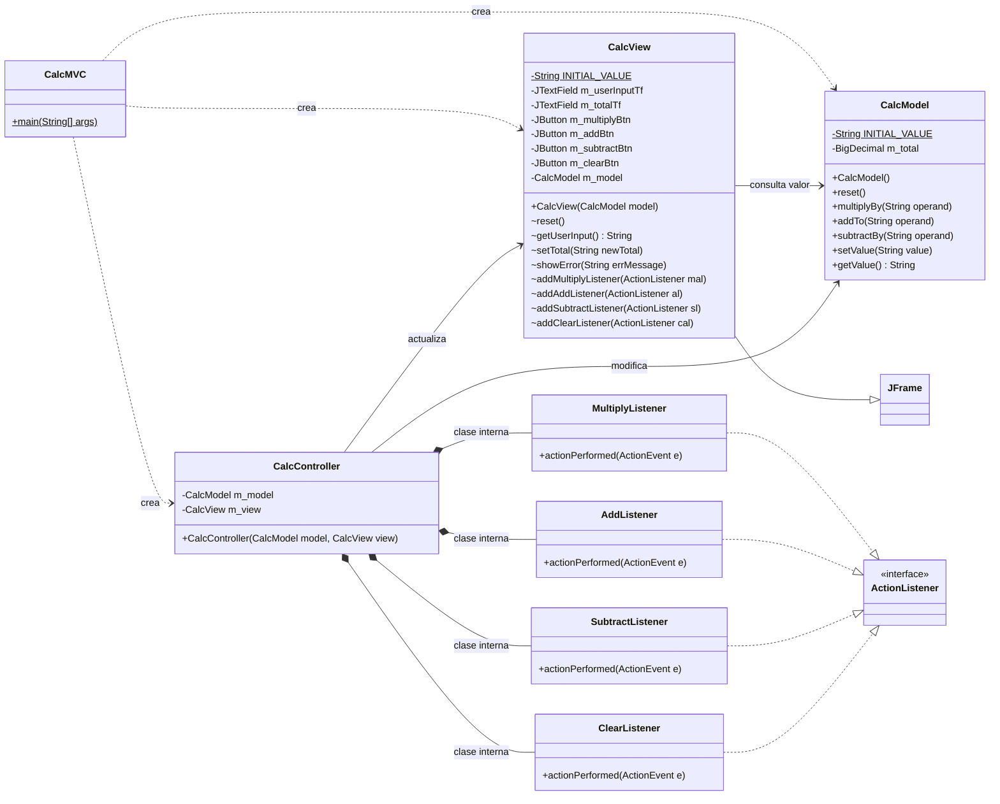

# Calculadora MVC en Java

Calculadora con el patrón **Modelo-Vista-Controlador (MVC)**, basada en el ejemplo de Fred Swartz. Trabaja con **enteros largos y decimales largos** (sin límite práctico de tamaño) y opera con números recibidos como **cadenas de texto**. Operaciones: **multiplicar, sumar y restar**.

## Contenido del repositorio

```
src/
 ├── CalcMVC.java         Programa principal
 ├── CalcModel.java       Modelo
 ├── CalcView.java        Vista
 └── CalcController.java  Controlador
```

Video explicativo: **[PEGAR AQUÍ EL URL DEL VIDEO]**

## Cómo ejecutarlo

Con Java instalado, desde la carpeta `src`:

```
javac *.java
java CalcMVC
```

También se puede ejecutar con el botón **Run** de VS Code sobre `CalcMVC.java`.

## Qué se implementó

| Clase | Rol | Responsabilidad |
|---|---|---|
| `CalcMVC` | Principal | Crea una sola copia del modelo, la vista y el controlador, los conecta y muestra la ventana. |
| `CalcModel` | Modelo | Guarda el total (`m_total`) y sabe multiplicar, sumar, restar, reiniciar, asignar y devolver el valor. No conoce la interfaz. |
| `CalcView` | Vista | Ventana Swing (`JFrame`) con el campo de entrada, el total y los botones Multiply, Add, Subtract y Clear. Solo muestra datos y entrega lo que escribió el usuario. |
| `CalcController` | Controlador | Escucha los botones mediante clases internas (`MultiplyListener`, `AddListener`, `SubtractListener`, `ClearListener`), consulta la vista, pide el cálculo al modelo y actualiza la vista. |

### Cambios respecto al ejemplo original

1. **`BigInteger` → `BigDecimal`** en el modelo, para aceptar enteros largos y decimales largos. Los métodos siguen recibiendo y devolviendo `String`.
2. **`getValue()` usa `toPlainString()`** para que los resultados no aparezcan en notación científica.
3. **Valor inicial `"1"` en el modelo.** En el original el modelo reiniciaba en `"0"` y la vista en `"1"`, y tras presionar *Clear* todo se multiplicaba por 0.
4. **`.trim()`** a la entrada del usuario en el controlador, para ignorar espacios accidentales.
5. **Nuevas operaciones: suma y resta.**
   - Modelo: métodos `addTo(String)` y `subtractBy(String)`.
   - Vista: botones `Add` y `Subtract`, y los métodos `addAddListener` y `addSubtractListener`.
   - Controlador: clases internas `AddListener` y `SubtractListener`.

### Flujo al presionar un botón de operación (Multiply, Add o Subtract)

1. La vista avisa al controlador (el listener del botón).
2. El controlador lee el texto con `m_view.getUserInput()`.
3. El controlador llama al método de la operación en el modelo (`multiplyBy`, `addTo` o `subtractBy`).
4. El controlador lee `m_model.getValue()` y lo manda a `m_view.setTotal(...)`.
5. Si el texto no es un número, se captura `NumberFormatException` y la vista muestra el error.

### Pruebas realizadas

El total inicia en `1`.

| Acción | Total |
|---|---|
| Add `5` | `6` |
| Subtract `2` | `4` |
| Multiply `2.5` | `10.0` |
| Add `0.25` | `10.25` |
| Subtract `20` | `-9.75` |
| Clear | `1` |
| Entrada `abc` | Ventana de error "Bad input: 'abc'" |

## Diagrama de clases



## Estrategia para incrementar las operaciones

### Lo que se implementó: enfoque directo

Para cada operación nueva se agregó: un método en el modelo, un botón y su `addXListener` en la vista, y una clase interna `XListener` en el controlador. Con suma y resta ya se nota el problema: los tres listeners son **casi idénticos** (leer entrada, operar, mostrar, manejar error) y cada operación obliga a modificar las **tres** clases. Para dos o tres operaciones es aceptable; para muchas, no escala bien porque no cumple el principio abierto/cerrado.

### Patrón Command

Cada operación se encapsula en un objeto (`Operation` con `execute()`), por ejemplo `MultiplyCommand`, `AddCommand`, `SubtractCommand`.

**Ventajas**
- Agregar una operación es crear **una clase nueva**, sin tocar las existentes.
- El controlador puede usar **un solo listener genérico** para todos los botones.
- Permite **deshacer/rehacer** y guardar un historial, porque cada comando es un objeto que se puede almacenar.

**Desventajas**
- Agrega varias clases e interfaces a un programa muy pequeño.
- Si no se necesita deshacer, historial ni macros, el beneficio real es poco.
- Las operaciones aritméticas son funciones sin estado: ahí el Command resulta más pesado de lo necesario.

### Estrategia considerada para crecer

Si no se requiere deshacer ni historial, una opción más ligera es **representar cada operación como una función intercambiable** (patrón **Strategy**, o un `enum Operation` con un `BinaryOperator<BigDecimal>` por operación):

1. El modelo tiene un único método `apply(Operation op, String operand)`.
2. La vista crea los botones a partir de la lista de operaciones.
3. El controlador usa un solo `OperationListener` que recibe la operación elegida.

Agregar una operación nueva es agregar **un valor al enum**, y se elimina el código repetido de los listeners. Se mantiene MVC porque el modelo sigue haciendo el cálculo, la vista solo muestra y el controlador solo coordina.

Si más adelante se pidiera **deshacer**, ese sería el momento de pasar a **Command**, o de combinarlos: Strategy para el cálculo y Command para el historial.

### Consideraciones para futuras operaciones

- **División:** manejar la división entre cero (`ArithmeticException`) y definir la escala/precisión del resultado (por ejemplo con `MathContext`), porque `BigDecimal` falla con resultados de decimales infinitos como 1/3.
- **Errores:** el controlador debe capturar las nuevas excepciones y mostrarlas con `showError`.
